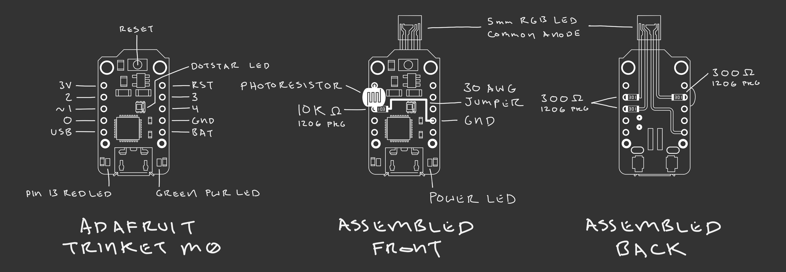
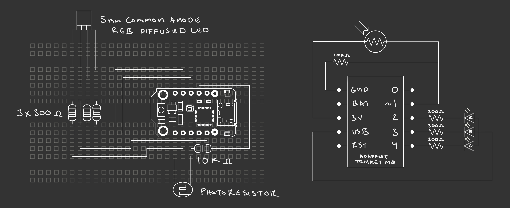
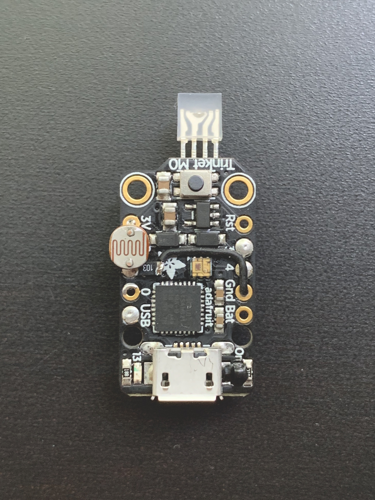
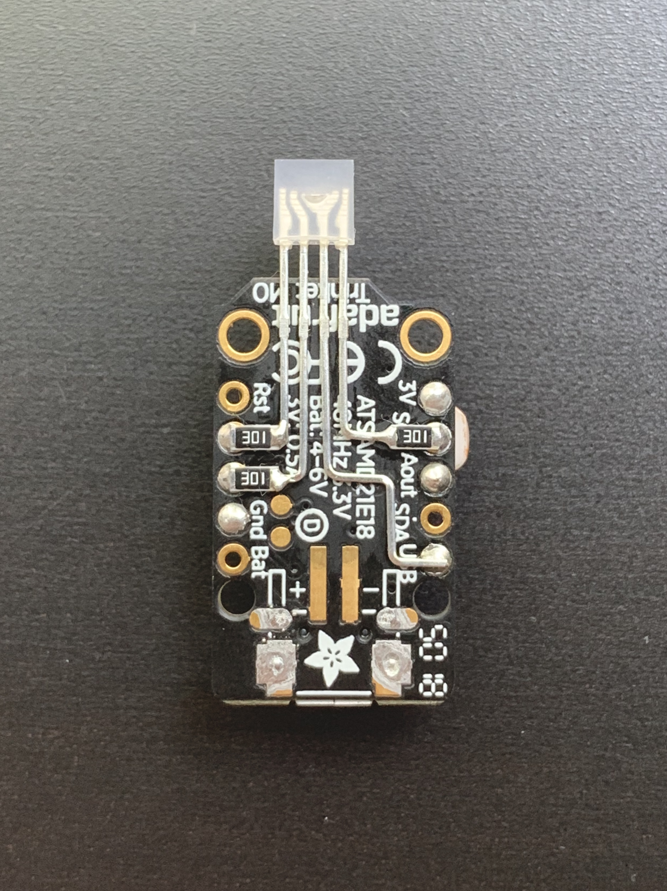

Do Not Disturb
==============

A hardware and software project for those who need a way to communicate availability without being disturbed. There will be some soldering involved, and although this can be done on any OS we'll assume OSX here.

Hardware
--------



### Bill of Materials

| <br>Item | <br>Quantity | <br>Price |
| ----                                 | :--:                                     | :--:                                  |
| [Adafruit Trinket M0](https://www.adafruit.com/product/3500) | 1 | ~$9 |
| [Diffused Rectangular 5mm RGB LED (common anode)](https://www.adafruit.com/product/2739) | 1 | ~$6 for 10 |
| [Photoresistor](https://www.adafruit.com/product/161) | 1 | ~$1 |
| [300 Ω Resistors (1206 SMD)](https://www.mouser.com/Passive-Components/Resistors/SMD-Resistors-Chip-Resistors/_/N-7h7yu?P=1z0x8a5Z1z0x6frZ1yzmoty) | 3 | ~$0.30 |
| [10K Ω Resistor (1206 SMD)](https://www.mouser.com/Passive-Components/Resistors/SMD-Resistors-Chip-Resistors/_/N-7h7yu?P=1z0x6frZ1yzmotyZ1yzmno7) | 1 | ~$0.15 |
| [MicroUSB Data Cable](https://www.amazon.com/dp/B0711PVX6Z/ref=cm_sw_em_r_mt_dp_U_NwJdDb4PMCY4R) | 1 | ~$5 |
| [30AWG Stranded-Core Wire (black)](https://www.adafruit.com/product/3164) | 1 inch | ~$5 |

### Wiring



### Tips

- We can't control the 'on' led, it will always be green, it will always be on and we really don't want to be giving the wrong idea that you are free to chat.  You've got a lot of options but I recommend getting some liquid electrical tape and just putting a dab of it right on top.  It's non-destructive, blends in with the black solder mask of the board and comes off in one nice chunk if you ever choose to clean it up.

- If this is your first time soldering you'll need to exercise some patience. Working with 1206 SMD resistors is not the ideal first project but it can be done. You'll want to get yourself some tweezers, a flux pen, and a stable surface. I've found folks have the most success here by pre-loading the pad with solder, then while holding the resistor in place with the tweezers press down the side that is right over the pad. It makes a decent joint especially if you apply some flux to the pad before pre-loading and after. This will then allow you to more easily solder the connections to the LED leads.

- Recommended assembly order:

  1. Apply flux and pre-load the back of pins 2, 3, and 4 with solder.
  2. Re-apply flux and solder the three 300 Ω resistors on the back of the Trinket M0 to pins 2, 3, and 4.
  3. Using rounded needle nose pliers bend the RGB led leads as shown in the photo. Test place between bends.
  4. Using a clamp of some sort (e.g. a clothes pin works great) pin the led to the back of the board.
  5. Apply flux at each connection point with a resistor and solder in place.
  6. Flip the board over, apply some flux to pins 3V and ~1, solder in the photoresistor.
  7. Apply flux to the solder joint on pin one and using the same method as we did on the back solder in the 10K Ω resistor.
  8. Trim and shape a piece of jumper wire to run from the resistor off pin ~1 to the Gnd pin.
  9. Using your clamp from step 4, hold the jumper in place, apply some flux and then solder. The Gnd connection in the photo is soldered from the back of the board.

Software
--------

This project is built around the Adafruit Trinket M0. It's a tiny microcontroller that utilizes a Cortex M0+ chip giving it a lot of power and enabling it to use CircuitPython. This removes a lot of the road blocks newcomers struggle with when first getting started on microcontrollers. When you plug the board into your computer via a USB cable it shows up as a thumb drive and you plop the code right onto it, no compiling or messing with serial drivers. Plus we're also working with Python, so yay!

### Hardware:

1. Build the hardware, see above
2. Upload CircuitPython 4.X firmware to device
   - Download the latest from [here](https://circuitpython.org/board/trinket_m0/), the large 'DOWNLOAD .UF2 NOW' button
   - Plug in and backup any existing projects on your Trinket M0
   - Double click the Trinket's reset button to enter bootloader mode, the red light will flash and a new drive titled TRINKETBOOT will be mounted
   - Place the downloaded UF2 file into this newly mounted drive, it will automatically be applied and the device will reset
3. Upload CIRCUITPY contents to device
   - Once the firmware is done and the device has reset you'll see a CIRCUITPY device mounted, copy the CIRCUITPY contents of this repository to the newly mounted drive, that's it!

### Slack:

1. __Get your member ID__ This is not the same as your display name or user name as those are namespace specific. Rather you need to get the universal member id which at the time of writing is available when viewing your profile and selecting 'more'.
2. __Get your legacy token or create an app oath token__

#### Legacy Tokens

Legacy tokens can no longer be generated, but if you created one before it can be accessed [HERE](https://api.slack.com/legacy/custom-integrations/legacy-tokens).

#### OAuth Tokens

It's possible to use OAuth Tokens in Slack App [instead of a Legacy Token](https://github.com/nlopes/slack/issues/184).  Using the bot and users.profile OAuth Scopes, the access token functions similarly to the Legacy Token but with more tailored permissions.
To achieve this you'll need to:

1. Create a [Slack App](https://api.slack.com/apps)
2. Add the bot and users.profile:read [OAuth Scopes](https://api.slack.com/docs/presence-and-status)
3. Use the Bot User OAuth Access Token in place of the Legacy Token

If your Slack App does not contain a bot OAuth scope, you will not see an option for the Bot User Access Token, and attempting to connect with the default OAuth Token may result in a missing_scope error from the Slack API.

### Server:

1. Grab dependencies

        go get github.com/tarm/serial
        go get github.com/nlopes/slack

2. Export `SLACKTOKEN` and `SLACKUSERID`, recommend using direnv.

        export SLACKTOKEN=[yourslacktoken]
        export SLACKUSERID=[youruserid]
3. Compile the application

        go build -ldflags "-X main.slackToken=$SLACKTOKEN -X main.slackUserID=$SLACKUSERID" -o dndserver server/go/main.go

4. Create a local service so it runs automatically at boot

Develop
-------


| Light Color | Light Behavior | Slack Status Text | Slack Status Emoji | Other |
| :---------- | :------------- | :---------------- | :----------------- | :---- |
| blue    | solid   | - | - | server has not connected to trinket |
| red     | solid   | 'focused', 'busy' | - | |
| red     | solid   | - | :triangular_flag_on_post:, :red_circle:, :woman-gesturing-no:, :man-gesturing-no:, :male-technologist:, :female-technologist: | |
| red     | pulsing | 'in a meeting', 'on a call' | - | |
| red     | pulsing | - | | |
| green   | solid   | __default__ | __default__ | If there is no status or one we don't trigger on the light will default green. |
| green   | pulsing | - | - | - |
| yellow  | solid   | 'thinking' | - | |
| yellow  | solid   | - | :thinking_face:, :sleeping:, :shushing_face: | |
| yellow  | pulsing | - | - | - |

* If there is Status Text then we ignore the Status Emoji, only if there is no Status Text do we set the light based on Status Emoji.

You'll want:

- a serial terminal emulator
- your favorite text editor
- a slack api
- ...

### Connecting via Serial

0. find the device under `/dev/`
0. install minicom and configure `brew install minicom; minicom -s`
  - 9600 8N1
  - set port
0. run  `minicom`

You are now connected, you can send commands to test, eg:

```minicom
> red
setting solid - (40, 0, 0)
>
```

`esc + z, x` to exit from minicom

| Trinket M0 Front | Trinket M0 Back |
| :-----------: | :----------: |
|  |  |

